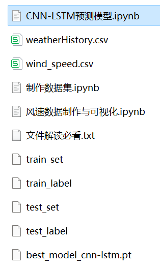
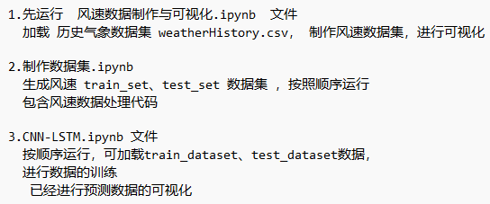

# Stepwise Prediction Model (II) CNN-LSTM Model

Multi-feature variables include the following:
Including wind speed data, as well as the already generated and prepared wind speed dataset and label set, corresponding codes can be run.
Includes code for data preprocessing and the complete CNN-LSTM model prediction code.
Environment: Python 3.9
\n        \n  
\n        \n  
  

## Images

<!-- PAYMENT_BLOCK -->

## Get this dataset

- Payment link (Stripe): [Buy now](https://buy.stripe.com/3cs8yP7sY87d0vu9AB)
- Payment QR code: 

<!-- /PAYMENT_BLOCK -->
